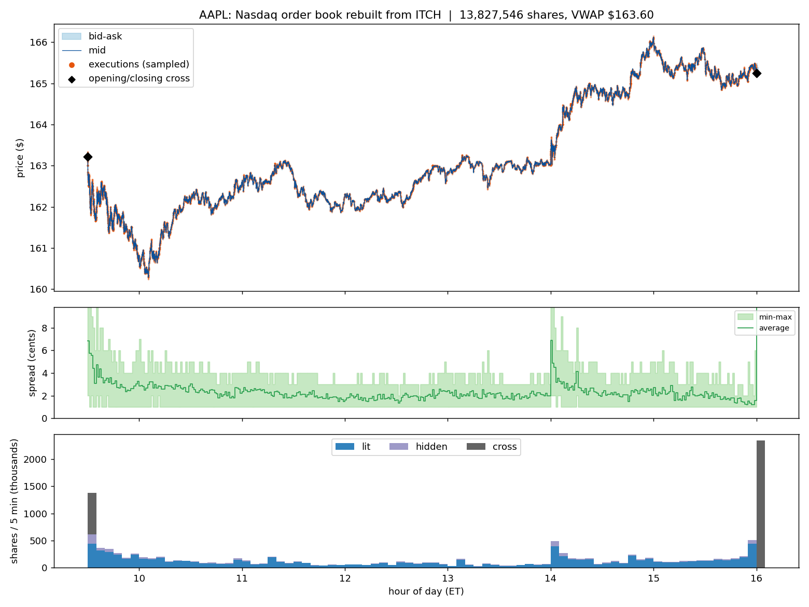
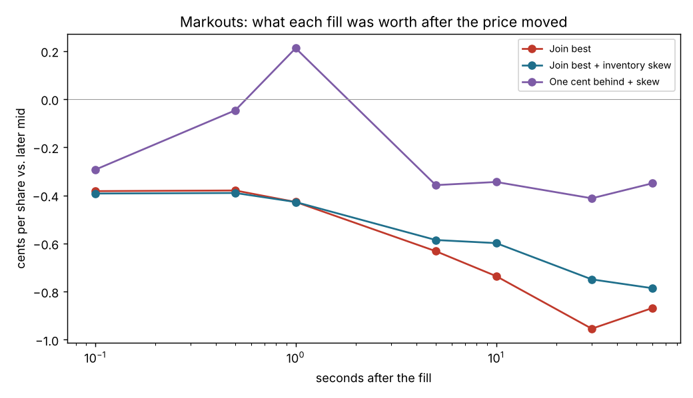
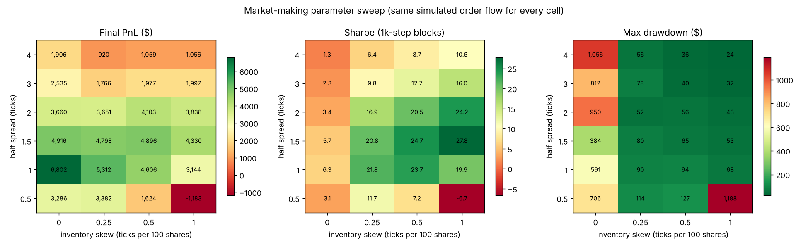

# OrderBook

[](https://github.com/adamdn-code/orderbook/actions/workflows/ci.yml)

**[Live demo: replay Apple's order book on 2019-01-30](https://adamdn-code.github.io/orderbook/)**, rebuilt from 368M raw Nasdaq messages.

A single-threaded limit order book in Python with price-time priority, like the matching engine an exchange runs. No dependencies.

## Features
- Limit, market, and IOC (immediate-or-cancel) orders
- Price-time priority: best price first, then first-come-first-served
- Partial fills; trades execute at the resting order's price
- Cancel and modify (shrinking keeps your place in line; a price change or size increase sends you to the back)
- Best bid/ask, spread, and depth by price level

## How it works
Each side keeps a `dict` of price → `deque` of orders (FIFO for time priority) and a heap of prices for O(log n) best-price lookup. Emptied levels are removed from the heap lazily. Prices are integers (cents) so comparisons are exact.

## Multithreaded engine (`engine.py`)
`MatchingEngine` wraps one `OrderBook` per symbol:
- Any number of client threads call `submit`, `cancel`, `modify` at once. Each call goes into that symbol's thread-safe queue and returns a `Future` right away.
- Each symbol has a single matching thread (single writer), so price-time priority is never broken by a race. Different symbols match in parallel.
- Reads (`best_bid`, `depth`, ...) take a per-book lock, so they always see a consistent book.
- Bad orders come back as exceptions on the `Future`; an optional `on_trade` callback fires for every fill.

Why not a buy thread and a sell thread? Every buy can hit a sell, so both threads would lock the same book on every match and you'd pay for threads without getting parallelism. Real exchanges use one writer per instrument.

Python's GIL means threads give concurrency here, not a CPU speedup. The same design in C++/Rust, or one process per symbol, runs truly in parallel.

The stress test runs 8 threads × 2,000 orders across 3 symbols and checks that no quantity is lost and no book ever crosses.

## Run
```bash
python orderbook.py          # single-book demo
python engine.py             # 8 threads, 40k orders, 3 symbols
python -m unittest -v        # all tests
```

## C++ version
`cpp/` has a C++17 port of the book plus a lock-free engine (one SPSC ring per client per symbol, no per-order allocation), with tests and benchmarks. See `cpp/README.md`.

## Replaying real Nasdaq data
`cpp/itch/` parses Nasdaq's raw TotalView-ITCH 5.0 feed and rebuilds every stock's order book with the C++ book. On a full real day (2019-01-30): 368 million messages and 8,695 stocks. **0 of 198 million** executions, cancels, deletes and replaces named an order the book didn't have, the book was empty at the close as Nasdaq's is, and 99.2% of executions hit the order the book had first in line. See `cpp/itch/README.md`.



## Market making on real Nasdaq data
`backtest/real_mm.py` runs a market maker against all 1.67M of Apple's order events on 2019-01-30, with quotes as shadow orders whose queue position is tracked exactly from the order-level feed. Quoting at the best bid and ask all day **loses money**. Fills average 0.6¢ better than the mid, but within 0.1 s the mid has moved about 1¢ against them (adverse selection). Every step slower, from 0 to 100 ms, loses more: −$2.7k to −$10.9k for the day. See `backtest/README.md`.



## Python bindings and market-making backtest
`backtest/` drives the C++ book from Python through `obfast`, a CPython extension module (12.9× faster than the pure-Python book on the same orders). It uses it to backtest a market-making strategy against simulated informed and uninformed order flow, sweeping quote width and inventory skew. Inventory skew cut drawdowns 7–11× and raised risk-adjusted return about 4×. See `backtest/README.md`.



## Next steps
- One process per symbol (multiprocessing) for real CPU parallelism
- Stop orders, FOK (fill-or-kill)
- Benchmark orders/second and replay real market data
