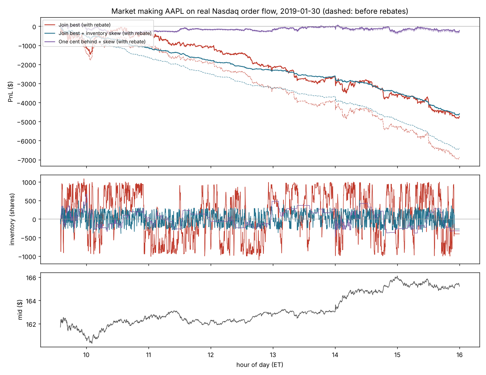
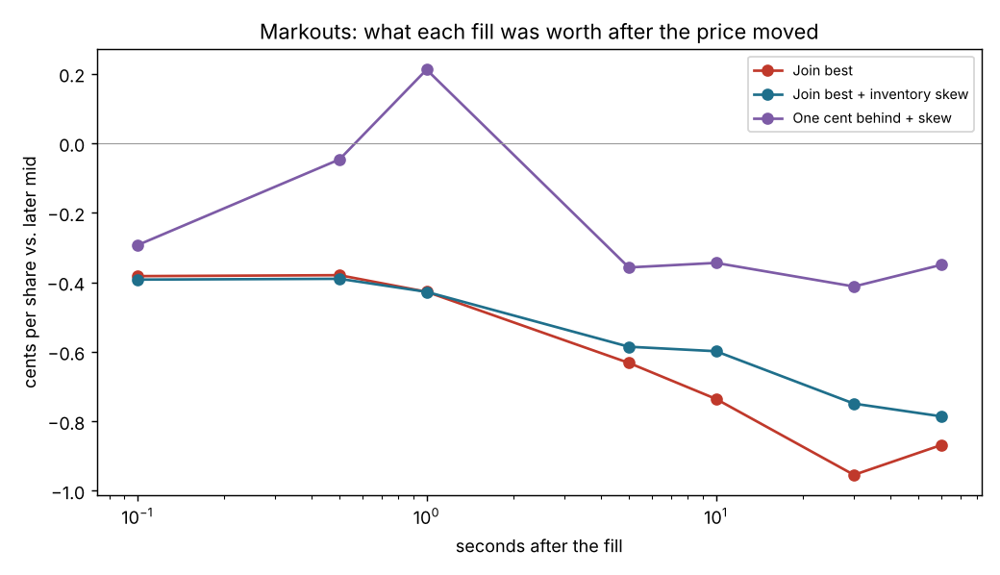
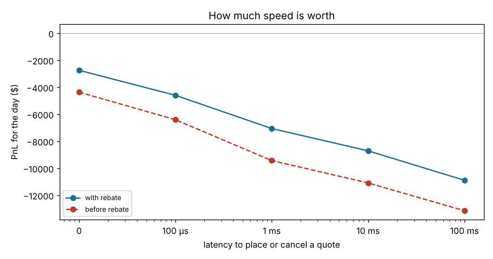
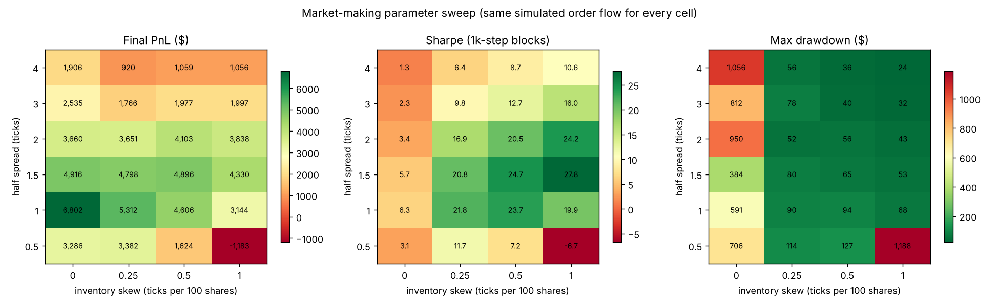
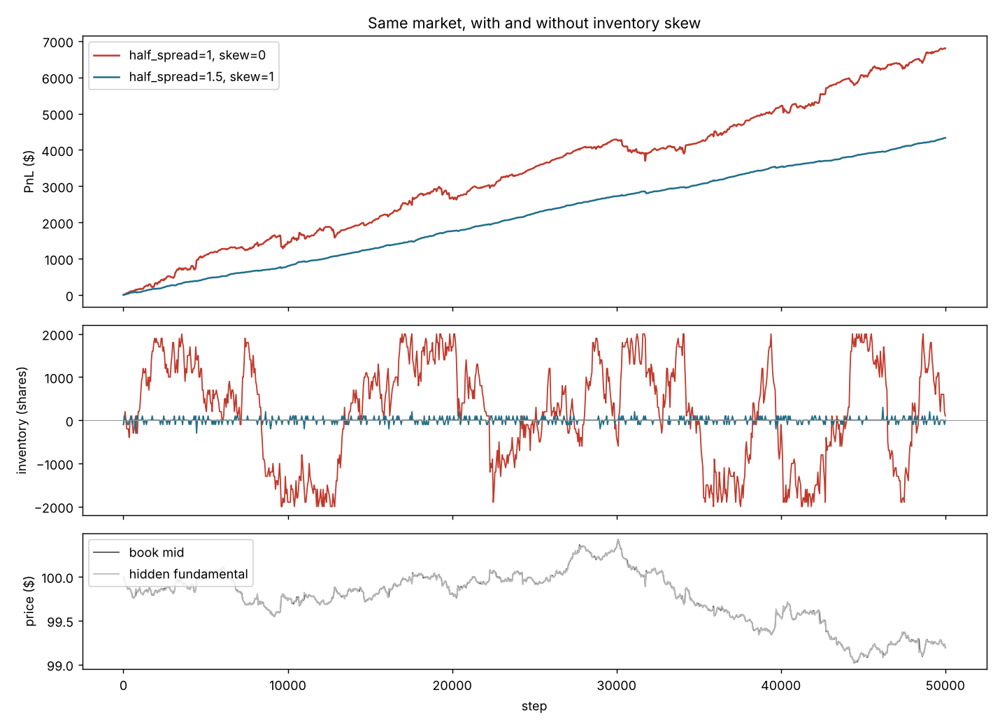

# Market-making backtest on the C++ order book

A market-making strategy, written in Python, trading in a simulated market and then on a full day of real Nasdaq order flow for Apple. Both run on the C++ order book through `obfast`, a CPython extension module.

## Run it
```bash
make -C cpp python                         # build obfast (needs: sudo apt install python3-dev)
python backtest/run_backtest.py            # 24-setting sweep, ~20 s; writes backtest/results/
python backtest/bench_bindings.py          # pure-Python book vs C++ book, same orders
python backtest/real_mm.py ~/itch/AAPL_events.csv   # real-data study (see below for getting the file)
python -m unittest discover -s backtest -v # binding + backtest tests
```
Needs `numpy`, `pandas` and `matplotlib`.

## The bindings
`cpp/bindings/obfast.cpp` exposes the C++ book to Python through the CPython C API directly, with no pybind11 or other dependency. The order methods use `METH_FASTCALL`, so a call costs little more than the C++ work, and C++ exceptions become Python exceptions (`obfast.OrderBookError` is a `ValueError`).

```python
import obfast
book = obfast.Book()
book.limit(1, obfast.SELL, 100, 10_050)   # -> []
book.limit(2, obfast.BUY, 40, 10_100)     # -> [(2, 1, 10050, 40, 0)]  (buy_id, sell_id, price, qty, aggressor)
book.mid(), book.depth(obfast.SELL), book.remaining(1)
```

Same 300k random orders, driven from a Python loop:

| Book | Orders/s |
|---|---|
| Pure Python (`orderbook.py`) | 0.37 M |
| C++ via `obfast` | **4.77 M (12.9×)** |

Both books produce identical trades. A randomized test checks this on 20k mixed adds, cancels and modifies, and memory stays flat over millions of calls, so no reference counts leak.

## On real data: market making Apple on 2019-01-30 (`real_mm.py`)
The simulation above is stylized. This part runs the strategy against the real thing: every Apple order event Nasdaq reported that day (1.67M events, exported with `itch_replay --track AAPL --events`). The book is rebuilt with the C++ book through `obfast`.

**How fills work.** The market maker's quotes are *shadow orders*: they sit in a virtual queue next to the real orders but don't change what anyone else did. Because ITCH names every order, the backtest knows exactly which real orders are ahead of each quote when it's placed. A quote fills when:
1. the orders ahead of it trade or cancel, and an order behind it then trades at its price (the incoming order would have reached the quote first), or
2. the market trades through its price, or
3. a new order on the other side is priced through it.

Placing and cancelling take effect after a latency. Even at zero latency nothing happens mid-sweep, since one incoming order that takes several levels shows up as several executions with the same timestamp. `test_real_mm.py` tests each rule on hand-written event streams.

| Strategy (100 µs latency, 100-share quotes, 9:35–15:55) | PnL | With rebate* | Shares | Edge at fill | Markout 1 s | Markout 60 s |
|---|---|---|---|---|---|---|
| Join the best bid and ask | −$6,879 | −$4,742 | 1,068,666 | +0.60¢ | −0.43¢ | −0.87¢ |
| Join best + inventory skew | −$6,405 | −$4,597 | 903,776 | +0.60¢ | −0.43¢ | −0.79¢ |
| One cent behind best + skew | −$299 | −$234 | 32,799 | +1.81¢ | +0.21¢ | −0.35¢ |

*Assumes a $0.0020/share rebate for adding liquidity; Nasdaq's actual rate depends on the firm's volume tier.



**What it shows**
- **Adverse selection beats the spread.** Each fill is on average 0.6¢ better than the mid at that moment. Within a tenth of a second the mid has moved about 1¢ against it (markout −0.38¢), and it keeps drifting the wrong way over the next minute. The orders that trade with a resting quote are disproportionately the ones that know where the price is going, so quoting at the best price all day loses money steadily even before inventory risk.
- **Inventory skew halves inventory swings but doesn't fix the problem.** Max inventory falls from ±1,097 to ±507 shares and drawdown shrinks, but the loss per share is about the same, because the losses come from adverse selection, not from holding inventory.
- **Standing one cent back is safer but barely trades** (420 fills), and with so few fills its markouts are noisy.



**Latency is money.** The same skewed strategy, varying only how long a place or cancel takes:

| Latency | 0 | 100 µs | 1 ms | 10 ms | 100 ms |
|---|---|---|---|---|---|
| PnL with rebate | −$2,745 | −$4,597 | −$7,059 | −$8,711 | −$10,892 |
| Edge at fill | +0.87¢ | +0.60¢ | +0.34¢ | +0.22¢ | +0.10¢ |
| Markout 1 s | −0.29¢ | −0.43¢ | −0.55¢ | −0.68¢ | −0.82¢ |

Every step slower makes things worse, because a slow cancel leaves a stale quote out for faster traders to hit. That's why market makers spend so much on speed. Even at zero latency a naive strategy loses: profitable market making needs a signal for when *not* to quote (the next thing to try here: pull quotes when the book imbalance or recent trades point against them).



**Limitations**
- Shadow orders have no market impact. In reality the market maker's 100 shares would have taken some fills from other orders and could have changed what others did, so fill counts are on the high side.
- One stock, one day. The rebate is an assumption. Inventory left at 15:55 is marked at the closing auction price.
- Fills at the open and close auctions and hidden-order executions aren't modeled.

```bash
./cpp/build/itch_replay ~/itch/01302019.NASDAQ_ITCH50.gz --symbols AAPL --track AAPL --events --out ~/itch
python backtest/real_mm.py ~/itch/AAPL_events.csv     # ~1 min; writes backtest/results/real/
```

## The market (`sim.py`)
- A hidden **fundamental** price follows a random walk with occasional **news jumps**.
- **Liquidity traders** place limit orders a few ticks from the fundamental. Each one rests for a random lifetime, then cancels.
- **Informed traders** send market orders that lean toward the fundamental: when the book's mid is below it, buys are more likely. They're the reason market making is hard, because the orders that hit your quotes are disproportionately the ones that know where price is going.
- Every strategy sees the same random draws, so differences between settings come from the strategy, not luck.

## The strategy
Every step the market maker cancels its quotes and re-quotes around the mid of everyone else's orders:

```
bid = mid - half_spread - skew * inventory / 100
ask = mid + half_spread - skew * inventory / 100
```

- **Half spread**: wider earns more per trade but trades less.
- **Inventory skew**: when long, shift both quotes down, so selling becomes more likely and buying less. This pulls inventory back toward zero.
- Hard cap of ±2,000 shares.

## Results (50k steps, 24 settings)




| Setting | PnL | Sharpe* | Max drawdown | Fills |
|---|---|---|---|---|
| Best PnL, no skew (half spread 1) | $6,802 | 6.3 | $591 | 8,831 |
| Best Sharpe (half spread 1.5, skew 1) | $4,330 | **27.8** | **$53** | 6,234 |
| Too tight + too much skew (0.5, skew 1) | −$1,183 | −6.7 | $1,188 | 15,832 |

Over 5 different seeds: no skew made $5,918 ± $1,023 with ~$612 drawdowns. Half spread 1.5 with skew 1 made **$4,278 ± $67** with ~$87 drawdowns.

**What it shows**
- **Inventory risk is the main risk.** Without skew, inventory swings between the ±2,000 limits (middle panel), and PnL rides the price. Skew keeps it near zero. That gives up about 35% of the profit, but drawdowns shrink 7–11×, risk-adjusted return rises about 4×, and results become far more predictable across seeds (±$67 vs ±$1,023).
- **There's a best spread.** Too tight (0.5) and the spread doesn't cover losses to informed traders. Too wide (3–4) and the strategy rarely trades. 1–2 ticks is best here.
- **Skew and spread interact.** With a 0.5-tick spread, a 1-tick skew pushes one quote across the mid, so the strategy keeps paying the spread to dump inventory and loses money.

*Sharpe here is the mean over the standard deviation of PnL across 1,000-step blocks, scaled by √(number of blocks). It's for comparing settings within this simulation, not an annualized number comparable to real strategies.

## Caveats
This is a stylized market: one venue, no fees or rebates, no latency (the strategy re-quotes every step for free), and background traders who don't react to the strategy beyond what the book does. The numbers show how the trade-offs work; they aren't an estimate of real-world profit.

`sweep.csv` also has each setting's average edge at fill (distance from mid when trading) and 100-step markout (where mid went afterwards), for digging into where the PnL comes from.
